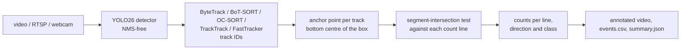

# Vehicle counter

Live detection, tracking and counting of vehicles in video files, RTSP streams or webcams. A
YOLO detector finds the vehicles and ByteTrack links them across frames. Each vehicle is then
counted **once** per line as it crosses, split by direction and class.

<p align="center"></p>
<sub>A UA-DETRAC camera the detector never saw in training: fine-tuned YOLO26m + FastTracker, one
count line across the road. Over the full 82 s clip it counts 36 and 52 vehicles per direction,
exactly the annotated numbers.</sub>



**Highlights**

- **Counted once, in the right direction.** A crossing is the intersection of a track's
  movement segment with the count *segment* (not the infinite line), and the sign of the cross
  product gives the direction. Each `(track, line)` pair counts at most once, so a vehicle that
  jitters on the line or is briefly lost is not counted twice. Tracks shorter than `min_hits`
  frames are ignored.
- **Measured, not eyeballed.** `vehicle-count-eval` runs the same counting rule over the
  annotated UA-DETRAC trajectories, on a count line placed across each camera's road from the
  direction of its traffic. The difference to the pipeline's counts therefore isolates detection
  and tracking errors from the counting logic.
- **Fine-tuning on traffic-camera data**: a UA-DETRAC → YOLO converter that splits by camera
  site and greys out the dataset's ignored regions, plus Slurm array jobs comparing YOLO26 n/s/m
  and five trackers.
- **Deployment**: works on any OpenCV source, reports processing FPS, and supports TensorRT FP16
  export and benchmarking.

## Quickstart

```bash
pip install -e .
vehicle-count --source traffic.mp4 --out runs/count/traffic          # COCO-pretrained YOLO26s
vehicle-count --source rtsp://camera/stream --config configs/two_lines.yaml --show
vehicle-count --source traffic.mp4 --set model=yolo26n.pt --set imgsz=640 --set tracker=tracktrack.yaml
```

Lines are defined in normalised image coordinates, so one config works for any resolution:

```yaml
lines:
  - name: northbound
    start: [0.05, 0.55]
    end: [0.48, 0.55]
    directions: [out, in]   # crossing onto the positive / negative side of start -> end
```

Outputs: `annotated.mp4`, `events.csv` (frame, time, track id, class, line, direction) and
`summary.json` (counts per line / direction / class, frames, FPS).

## Results

UA-DETRAC, 9 camera sites held out from training (15 % of the 60 annotated sequences, 637
vehicles crossing the count lines). Each camera gets one count line across its road, placed the
way an operator would draw it: perpendicular to the main direction of the annotated traffic,
through its middle and as wide as the lanes (`vehicle-count-eval --line auto`). The true count
runs the same counting rule over the annotated tracks.

| Detector | Tracker | Count error ↓ | Detector mAP50 / mAP50-95 (val) |
|---|---|---|---|
| YOLO26s, COCO weights | ByteTrack | 9.7 % | - |
| YOLO26s, fine-tuned | ByteTrack | 5.7 % | 0.719 / 0.540 |
| YOLO26m, fine-tuned | ByteTrack | 3.3 % | 0.808 / 0.639 |
| **YOLO26m, fine-tuned** | **BoT-SORT** | **2.7 %** | |
| YOLO26m, fine-tuned | OC-SORT | 3.3 % | |
| YOLO26m, fine-tuned | TrackTrack | 3.8 % | |
| YOLO26m, fine-tuned | FastTracker | 3.1 % | |

Count error is the sum over cameras and directions of |counted - true|, divided by the true
number of vehicles.

- **Fine-tuning matters most.** The COCO model has never seen these elevated, distant
  traffic-camera views; fine-tuning on UA-DETRAC cuts the counting error to under a third.
- **A gentle learning rate.** Consecutive video frames are near-duplicates, so the detector
  memorises the training cameras quickly. SGD at lr 0.002 instead of Ultralytics' 0.01 keeps the
  pretrained features: held-out mAP50-95 0.593 instead of 0.540 for YOLO26s, and 0.639 for the
  YOLO26m in the table.
- **The trackers are within about one point of each other.** BoT-SORT counts most accurately:
  17 vehicles off out of 637. FastTracker and OC-SORT follow at 3.1 and 3.3 %.
- **Detector:** vans are often indistinguishable from cars in UA-DETRAC, which lowers the
  per-class mAP; the class does not change the count.
- **Speed:** TensorRT FP16 engines take 2.4 ms (YOLO26s) and 2.8 ms (YOLO26m) per 960 px frame
  on an A100, 417 and 357 FPS, so one GPU can serve a dozen 25 fps cameras with the larger model.

## Model and tracker choices

- **YOLO26** (Ultralytics, January 2026) is the newest detector family in Ultralytics 8.4. It has
  an end-to-end head trained with one-to-one assignment, so it needs no NMS: the model returns at
  most 300 final boxes and the post-processing cost does not grow with the number of vehicles in
  the frame. That suits dense traffic and simplifies TensorRT/ONNX deployment. Ultralytics 8.4
  still runs the auxiliary one-to-many head with NMS unless `nms=False` is passed, so the config
  sets `nms: false` explicitly.
- **ByteTrack is the default tracker.** It keeps low-confidence detections for a second
  association pass, which matters for partly occluded cars, and it is within one point of the
  best tracker on UA-DETRAC. The newer trackers that ship with Ultralytics 8.4 are one
  `--set tracker=...` away and are compared by the `eval-counts` array job:
  BoT-SORT (camera-motion compensation, optional ReID), OC-SORT (observation-centric recovery
  after occlusion), TrackTrack (track-perspective association, CVPR 2025) and FastTracker
  (occlusion-aware ByteTrack). Inference precision is set with `quantize: 16` (the replacement
  for the deprecated `half` flag).

## Training and evaluation on a GPU cluster (Slurm)

```bash
bash scripts/setup_cluster.sh                       # once, on a login node
bash scripts/download_models.sh                  # weights + fonts; jobs run with YOLO_OFFLINE=1
# get UA-DETRAC into $DATA/ua_detrac, see scripts/get_ua_detrac.md
python3 slurm/generate.py convert-detrac --submit
python3 slurm/generate.py train-detectors --submit    # array: yolo26n / s / m
python3 slurm/generate.py eval-counts --submit        # array: COCO vs. fine-tuned, five trackers
python3 slurm/generate.py export-tensorrt --submit
```

## Project layout

```
src/vehicle_counter/
  counter.py            line-crossing geometry and the once-per-track counting rule
  tracking.py           Ultralytics YOLO + tracker behind a small protocol (mockable in tests)
  pipeline.py           frame loop, outputs, FPS
  annotate.py           boxes, trails, lines and a live counts panel
  cli.py                vehicle-count
  datasets/ua_detrac.py XML -> YOLO dataset, ignored regions, per-site split, MOT ground truth + video
  evaluate_counts.py    counting error vs. annotated trajectories
  train.py              resumable Ultralytics fine-tuning
tests/                  crossing geometry, double-count protection, scripted-track pipeline, converter
```

## Limitations

- Counting assumes the camera is static. On moving cameras use BoT-SORT, which compensates
  camera motion, and expect lower accuracy.
- Long occlusions can give a vehicle a new track ID. The once-per-track rule prevents
  double counting only while the ID is kept.
- UA-DETRAC is recorded in China. Validate on local footage before using the counts for
  traffic planning.

## References

- Y. Zhang et al., *ByteTrack: Multi-Object Tracking by Associating Every Detection Box*, ECCV 2022.
- N. Aharon, R. Orfaig, B.-Z. Bobrovsky, *BoT-SORT: Robust Associations Multi-Pedestrian Tracking*, arXiv:2206.14651, 2022.
- J. Cao et al., *Observation-Centric SORT: Rethinking SORT for Robust Multi-Object Tracking*, CVPR 2023.
- K. Shim et al., *Focusing on Tracks for Online Multi-Object Tracking* (TrackTrack), CVPR 2025.
- FastTracker, arXiv:2508.14370, 2025.
- L. Wen et al., *UA-DETRAC: A New Benchmark and Protocol for Multi-Object Detection and Tracking*, CVIU 2020.
- Ultralytics YOLO26, https://docs.ultralytics.com/models/yolo26.
